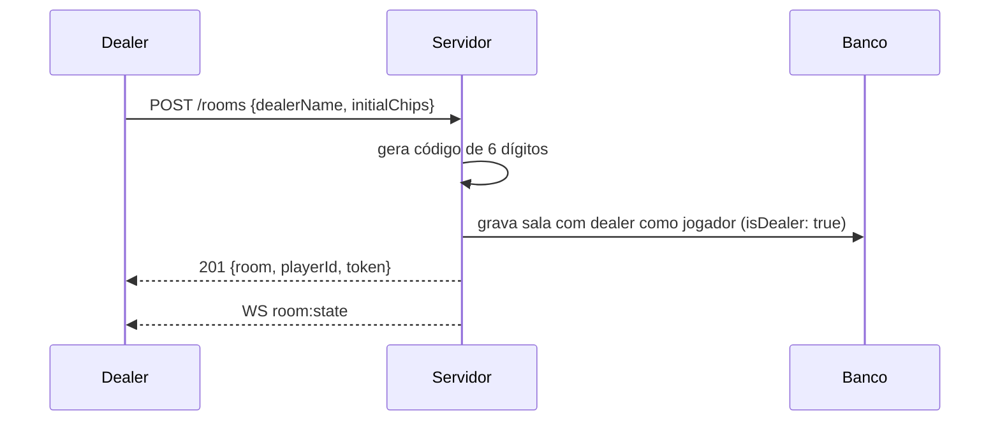
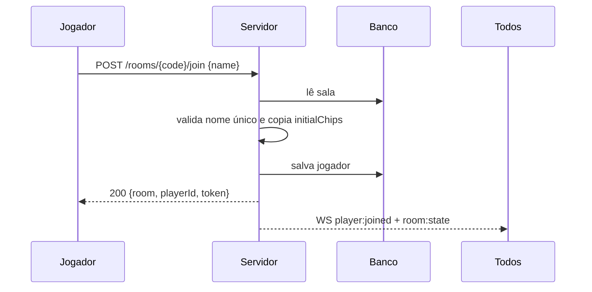

# 05 — Fluxos

> Status: rascunho revisado · Última atualização: 2026-11-20

## Criar sala



## Entrar na sala



## Apostar

```mermaid
sequenceDiagram
    participant J as Jogador
    participant S as Servidor
    participant B as Banco
    J->>S: POST /rooms/{code}/bets {amount} + Bearer token
    S->>B: lê sala (com mutex da sala)
    S->>S: valida inteiro positivo e saldo; debita; atualiza pot/currentBet
    S->>B: grava histórico e sala
    S-->>J: 200 {room}
    S-->>Todos: WS bet:placed + room:state
```

## Fechar rodada

```mermaid
sequenceDiagram
    participant D as Dealer
    participant S as Servidor
    participant B as Banco
    D->>S: POST /rooms/{code}/rounds/close {winnerId} + Bearer token
    S->>B: lê sala (com mutex da sala)
    S->>S: valida dealer e vencedor; pot -> winner.chips
    S->>S: zera apostas/pot/currentBet; round++
    S->>B: grava sala
    S-->>D: 200 {room, result}
    S-->>Todos: WS round:closed + room:state
```

## Observações

- O dealer joga normalmente: ele aposta como qualquer jogador e pode ser o vencedor escolhido por ele mesmo.
- Entrada tardia usa o mesmo fluxo de "entrar na sala", com `initialChips`.
- O QR code apenas codifica a URL da sala; não há segredo nele além do próprio código.
