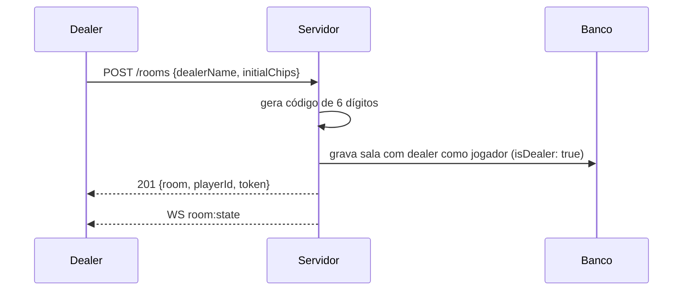
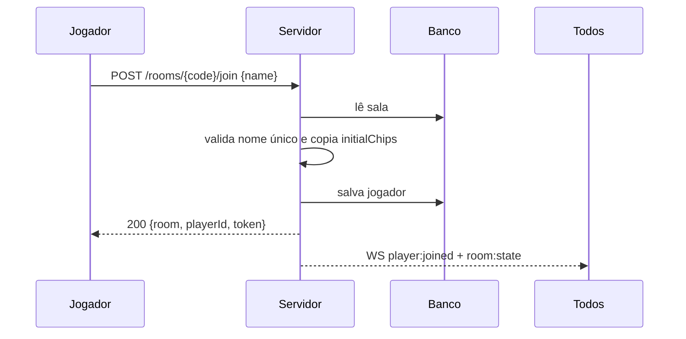

# 05 — Fluxos

> Status: rascunho revisado · Última atualização: 2026-11-20

## Criar sala



## Entrar na sala



## Iniciar partida (modo `turn`)

```mermaid
sequenceDiagram
    participant D as Dealer
    participant S as Servidor
    participant B as Banco
    D->>S: POST /rooms/{code}/start + Bearer token
    S->>B: lê sala (com mutex da sala)
    S->>S: valida dealer; trava turnOrder; currentPlayerId = 1º com fichas
    S->>B: grava sala (started: true)
    S-->>D: 200 {room}
    S-->>Todos: WS room:state
```

## Apostar

```mermaid
sequenceDiagram
    participant J as Jogador
    participant S as Servidor
    participant B as Banco
    J->>S: POST /rooms/{code}/bets {amount} + Bearer token
    S->>B: lê sala (com mutex da sala)
    S->>S: valida inteiro positivo e saldo
    S->>S: se turn: exige started, currentPlayerId == J e betThisRound + amount >= currentBet
    S->>S: debita; atualiza pot/currentBet; em turn avança a vez (pulando 0 fichas)
    S->>B: grava histórico e sala
    S-->>J: 200 {room}
    S-->>Todos: WS bet:placed + room:state
```

## Fechar rodada

```mermaid
sequenceDiagram
    participant D as Dealer
    participant S as Servidor
    participant B as Banco
    D->>S: POST /rooms/{code}/rounds/close {winnerId} + Bearer token
    S->>B: lê sala (com mutex da sala)
    S->>S: valida dealer e vencedor; pot -> winner.chips
    S->>S: zera apostas/pot/currentBet; round++
    S->>S: se turn: próximo jogador da ordem começa a rodada (giro)
    S->>B: grava sala
    S-->>D: 200 {room, result}
    S-->>Todos: WS round:closed + room:state
```

## Observações

- O dealer joga normalmente: ele aposta como qualquer jogador e pode ser o vencedor escolhido por ele mesmo. A coroa 👑 é fixa; quem gira a cada rodada é o jogador que começa.
- No modo `turn`, o dealer organiza a ordem, confere no diálogo "Começar partida" e a trava; depois disso `PUT /turn-order` é recusado. Quem entra tarde é acrescentado ao fim da ordem.
- Se todos os jogadores estiverem sem fichas, o próximo a entrar assume a vez; se alguém tiver 0 fichas durante a rodada, a vez o pula automaticamente.
- Entrada tardia usa o mesmo fluxo de "entrar na sala", com `initialChips`.
- O QR code apenas codifica a URL da sala; não há segredo nele além do próprio código.
